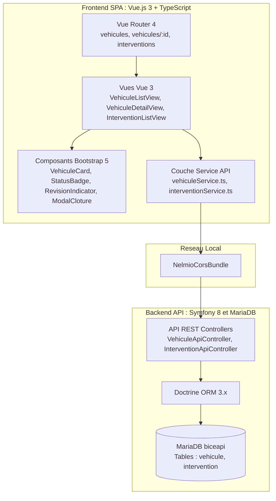
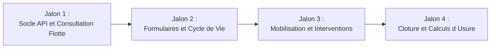

# Atelier Pratique : Système de Gestion BICE (Flotte et Interventions)
## Frameworks JavaScript / TypeScript (Vue.js 3, TypeScript, Bootstrap 5, Symfony 8)

**Module :** B2 FJSE328 - Atelier Frameworks JavaScript / TypeScript  
**Contexte Metier :** Brigade d'Intervention en Conditions Extremes (BICE)  
**Methode de travail :** Gestion de projet Agile guidee par Features et Jalons de validation (progression libre)  
**Architecture cible :** Full-Stack SPA (Frontend Vue.js 3 + TypeScript + Bootstrap 5 connecte directement a l'API REST Symfony 8 + MariaDB)

## Evaluation
Le projet se fera en groupe, avec un rendu final sous forme de dépôt GitHub contenant :
- Le code source du frontend Vue.js 3 + TypeScript (SPA)
- Le code source du backend Symfony 8 + MariaDB (API REST)

L'IA est autorisée pour la génération de code, mais **chaque étudiant doit comprendre et être capable d'expliquer le code produit**. Les commits Git doivent refléter la progression et les choix techniques. Vous êtes encouragés à documenter votre code, à faire des branches pour les fonctionnalités majeures et à utiliser les Pull Requests pour la revue de code entre membres du groupe.

Lors de la dernière séance le 04/12/2026, chaque groupe devra présenter son application fonctionnelle devant le jury, en expliquant :
- La structure du code et l'organisation des composants.
- La mise en oeuvre des Features et la gestion des Jalons.
- Les choix techniques et les difficultés rencontrées.

Une attention particuliere sera portée sur la compréhension de votre code (pour être sur que vous n'avez pas vibe codé sans comprendre).

---

## 1. Contexte Operationnel BICE

La BICE (Brigade d'Intervention en Conditions Extremes) est un corps d'elite de sapeurs-pompiers deploye sur les theatres d'operations complexes (feux de forets massifs, sauvetages en haute montagne, inondations majeures, accidents technologiques).

Apres avoir concu et exploite la base de donnees relationnelle de la brigade, le commandement operationnel souhaite informatiser son centre de logistique et de commandement.

La brigade demande une Single Page Application (SPA) reactive et fortement typee, directement connectee a son serveur d'API central, permettant de :
1. Superviser le parc de vehicules motorises (statut, categorie, compteurs horaires, revisions obligatoires).
2. Enregistrer et cloturer les sorties en intervention, avec repercussion automatique des heures moteur sur l'usure des engins.
3. Garantir une tracabilite reglementaire : aucun vehicule ne doit etre supprime du systeme (archivage obligatoire sous statut "Reforme" avec motif).

---

## 2. Architecture Technique Cible



### Stack technologique :
- **Client Web (Frontend) :**
  - Vue.js 3 (Composition API avec `<script setup lang="ts">`, `ref`, `computed`, `onMounted`)
  - TypeScript (typage strict sans type `any`, interfaces DTO pour les echanges avec l'API)
  - Vue Router 4 (routes dynamiques et parametrees)
  - Bootstrap 5 (classes de presentation, composants cards, modals, alerts, formulaires)
- **Serveur d'API (Backend) :**
  - Symfony 8 (installe sur l'environnement WSL)
  - Doctrine ORM (entites, migrations, relations ManyToOne)
  - NelmioCorsBundle (configuration CORS)
  - MariaDB (base de donnees relationnelle `biceapi`)

---

## 3. Organisation du Projet par Jalons

Le travail s'organise en progression libre a travers un carnet de commandes compose de 8 Features reparties en 4 Jalons. Chaque jalon valide une etape fonctionnelle complete connectee a l'API.



---

## 4. Module Pedagogique : Comprendre et Integrer Vue Router 4

Dans le projet de geometrie precedent, l'application tenait sur un seul ecran sans changement d'URL. Pour la BICE, l'application necessite plusieurs ecrans distincts :
- La liste des vehicules (`/vehicules`)
- La fiche detaillee d'un vehicule (`/vehicules/:id`)
- Le suivi des interventions (`/interventions`)
- Le declenchement d'une nouvelle intervention (`/interventions/nouvelle`)

C'est le role de **Vue Router 4**, la bibliotheque officielle de routage pour Vue.js.

### 4.1. Principe du routage cote client (SPA vs Web classique)

Dans une application web classique (comme Symfony avec des vues Twig) :
- Cliquer sur un lien `<a href="/vehicules">` envoie une requete HTTP complete au serveur.
- Le serveur genere du HTML et le navigateur recharge entierement la page (ecran blanc transitoire).

Dans une **Single Page Application (SPA)** avec Vue Router :
- La page HTML n'est chargee qu'une seule fois a l'ouverture du site.
- Quand l'utilisateur clique sur un lien `<RouterLink>`, Vue Router intercepte le clic, met a jour l'URL dans la barre d'adresse sans recharger le navigateur, et permute instantanement les composants affiches a l'ecran.

### 4.2. Installation

Dans le dossier du projet Vue.js :
```bash
npm install vue-router
```

### 4.3. Configuration du Routeur (`src/router.ts`)

Creez le fichier `src/router.ts` pour declarer les routes de l'application :

```typescript
import { createRouter, createWebHistory, RouteRecordRaw } from 'vue-router';
import VehiculeListView from './views/VehiculeListView.vue';
import VehiculeDetailView from './views/VehiculeDetailView.vue';
import InterventionListView from './views/InterventionListView.vue';
import NouvelleInterventionView from './views/NouvelleInterventionView.vue';
import NouveauVehiculeView from './views/NouveauVehiculeView.vue';

const routes: Array<RouteRecordRaw> = [
  // Redirection par defaut vers la flotte
  { path: '/', redirect: '/vehicules' },

  // Flotte de vehicules
  { path: '/vehicules', name: 'vehicules-list', component: VehiculeListView },
  { path: '/vehicules/nouveau', name: 'vehicule-nouveau', component: NouveauVehiculeView },

  // Route dynamique avec parametre :id
  { path: '/vehicules/:id', name: 'vehicule-detail', component: VehiculeDetailView },

  // Interventions
  { path: '/interventions', name: 'interventions-list', component: InterventionListView },
  { path: '/interventions/nouvelle', name: 'intervention-nouvelle', component: NouvelleInterventionView }
];

const router = createRouter({
  history: createWebHistory(),
  routes
});

export default router;
```

### 4.4. Enregistrement dans l'application (`src/main.ts`)

Informez l'instance de Vue qu'elle doit utiliser ce routeur :

```typescript
import { createApp } from 'vue';
import 'bootstrap/dist/css/bootstrap.min.css';
import './style.css';
import App from './App.vue';
import router from './router';

const app = createApp(App);
app.use(router);
app.mount('#app');
```

### 4.5. Structure de mise en page dans `src/App.vue`

Dans `App.vue`, deux composants fournis par Vue Router sont utilises :
1. `<RouterLink to="...">` : remplace les balises `<a href="...">` pour naviguer sans recharger.
2. `<RouterView />` : l'emplacement dynamique ou s'affiche le composant de la route active.

```html
<script setup lang="ts">
// Aucun code complexe ici, App.vue sert de gabarit global
</script>

<template>
  <div>
    <!-- Barre de navigation Bootstrap -->
    <nav class="navbar navbar-expand-lg navbar-dark bg-dark shadow-sm mb-4">
      <div class="container">
        <RouterLink to="/" class="navbar-brand fw-bold">BICE Operations</RouterLink>
        <div class="navbar-nav ms-auto">
          <RouterLink to="/vehicules" class="nav-link" active-class="active">Flotte de Vehicules</RouterLink>
          <RouterLink to="/interventions" class="nav-link" active-class="active">Interventions</RouterLink>
        </div>
      </div>
    </nav>

    <!-- Point d'insertion de la vue active -->
    <main class="container mb-5">
      <RouterView />
    </main>
  </div>
</template>
```

### 4.6. Les deux hooks indispensables dans vos composants

#### 1. Recuperer un parametre d'URL avec `useRoute()`
Dans `src/views/VehiculeDetailView.vue`, pour savoir quel vehicule charger :

```typescript
import { ref, onMounted } from 'vue';
import { useRoute } from 'vue-router';
import { getVehiculeById } from '../services/vehiculeService';
import type { VehiculeDto } from '../types/bice';

const route = useRoute();
// route.params.id correspond a la variable :id declaree dans router.ts
const vehiculeId = Number(route.params.id);

const vehicule = ref<VehiculeDto | null>(null);

onMounted(async () => {
  vehicule.value = await getVehiculeById(vehiculeId);
});
```

#### 2. Rediriger par le code avec `useRouter()`
Apres la creation d'un vehicule ou la cloture d'une intervention, pour renvoyer automatiquement l'utilisateur sur une autre page :

```typescript
import { useRouter } from 'vue-router';

const router = useRouter();

async function enregistrer() {
  await creerVehicule(payload);
  // Redirection automatique vers la liste des vehicules
  router.push('/vehicules');
}
```

---

## 5. Backlog des Features

### JALON 1 : Socle API et Consultation de la Flotte

Ce jalon met en place le backend Symfony pour les vehicules et l'interface Vue.js permettant de lister et consulter la flotte d'engins.

#### Feature 1 : Mise en place de l'API Vehicules et affichage du catalogue
En tant qu'officier logistique,  
Je veux visualiser l'ensemble des vehicules enregistres dans l'API avec des filtres dynamiques,  
Afin d'identifier rapidement la disponibilite des engins a la caserne.

**Criteres d'acceptation (Definition of Done) :**
- Côté Symfony : l'entite `Vehicule` est configuree dans Doctrine, avec migration executee sur MariaDB et commande de seed pour inserer des engins de test.
- L'endpoint `GET /api/vehicules` retourne la liste des vehicules au format JSON.
- Cote Vue.js : le projet est initialise en `vue-ts` avec Bootstrap 5 et Vue Router 4.
- Un service TypeScript `src/services/vehiculeService.ts` effectue l'appel `fetch` vers l'API.
- La page `/vehicules` affiche la liste des engins sous forme de tableau ou de cartes Bootstrap (immatriculation, marque, modele, categorie avec badge, statut).
- Des filtres reactifs permettent d'affiner l'affichage sans recharger la page :
  - Par categorie (VSAV, CCF, FPT, VSR, VPC).
  - Par statut operationnel (EN_SERVICE, EN_INTERVENTION, EN_REVISION, REFORME).
  - Par recherche textuelle sur l'immatriculation ou le modele.
- Un compteur indique le nombre de vehicules affiches par rapport au total.

#### Feature 2 : Fiche detaillee d'un vehicule et controle de revision
En tant que chef d'atelier mecanique,  
Je veux acceder a la fiche complete d'un engin via son identifiant (`/vehicules/:id`),  
Afin de verifier son compteur horaire et l'echeance de sa prochaine revision reglementaire.

**Criteres d'acceptation (Definition of Done) :**
- L'endpoint `GET /api/vehicules/{id}` retourne le detail d'un vehicule.
- Vue Router gere la route dynamique `/vehicules/:id` et recupere le parametre d'URL.
- La vue detaillee affiche :
  - Date de mise en service originale.
  - Compteur total d'heures d'intervention.
  - Date de derniere revision realisee.
  - Date limite programmee pour la prochaine revision.
- Regle de calcul d'alerte de revision :
  - Statut Vert (A jour) : prochaine revision dans plus de 30 jours.
  - Statut Orange (A prevoir) : prochaine revision dans moins de 30 jours.
  - Statut Rouge (Echue) : date limite depassee. Le vehicule est considere comme non deployable sans controle technique.
- Un bouton permet de retourner a la liste principale.

---

### JALON 2 : Formulaires Controles et Cycle de Vie

Ce jalon permet d'enrichir le parc de vehicules et d'appliquer la regle reglementaire de tracabilite interdisant la suppression physique.

#### Feature 3 : Creation et modification d'un vehicule dans l'API
En tant que gestionnaire du parc roulant,  
Je veux enregistrer un nouveau vehicule via un formulaire controle connecte a l'API,  
Afin d'ajouter de nouveaux engins a la flotte operationnelle.

**Criteres d'acceptation (Definition of Done) :**
- L'endpoint `POST /api/vehicules` recoit les donnees JSON, valide la coherence et persiste l'engin en base (reponse HTTP 201).
- La vue `/vehicules/nouveau` propose un formulaire Bootstrap valide :
  - Immatriculation obligatoire, convertie en majuscules, validee selon le format francais (regex).
  - Marque et modele obligatoires (au moins 2 caracteres).
  - Compteur horaire initial superieur ou egal a 0.
  - Date de prochaine revision posterieure a la date de derniere revision.
- Les erreurs de validation sont affichees sous chaque champ avec les classes Bootstrap `is-invalid` et `invalid-feedback`.
- Apres soumission reussie, l'utilisateur est redirige vers la liste avec une alerte de succes.

#### Feature 4 : Retrait du service actif et reforme (Soft Delete)
En tant que commandant de brigade,  
Je veux retirer du service actif un vehicule vetuste, accidente ou vendu sans le supprimer de la base,  
Afin de respecter l'obligation legale d'audit et de tracabilite.

**Criteres d'acceptation (Definition of Done) :**
- Aucun bouton de suppression physique n'est present dans l'interface (pas d'action DELETE destructive).
- L'endpoint `PATCH /api/vehicules/{id}/reformer` recoit la date de retrait, le motif de reforme et un commentaire, et passe le statut a `REFORME`.
- Dans l'interface, un bouton "Reformer le vehicule" ouvre une boite modale de confirmation.
- La modale exige la selection d'un motif officiel : Vetuste / Remplacement, Avarie lourde, Destruction en mission, Vente administrative.
- Une fois reforme, le vehicule apparait grise dans les listes avec un badge specifique et ne peut plus etre selectionne pour une intervention.

---

### JALON 3 : Mobilisation et Suivi des Interventions

Ce jalon introduit la gestion des sorties operationnelles et leur lien direct avec les engins mobilises.

#### Feature 5 : Declenchement d'une intervention et mobilisation d'un vehicule
En tant qu'operateur au centre de commandement,  
Je veux declarer un depart en mission et y affecter un vehicule disponible,  
Afin d'interdire sa reutilisation pendant toute la duree de l'intervention.

**Criteres d'acceptation (Definition of Done) :**
- Côté Symfony : l'entite `Intervention` est creee avec sa relation ManyToOne vers `Vehicule`.
- L'endpoint `POST /api/interventions` enregistre le depart, associe le vehicule, et bascule automatiquement le statut du vehicule a `EN_INTERVENTION`.
- La vue `/interventions/nouvelle` permet de saisir :
  - Intitule de l'intervention.
  - Localisation ou commune d'intervention.
  - Date et heure de depart (pre-remplie a l'heure courante).
  - Selection de l'engin engage.
- Regle de selection : le menu deroulant ne propose que les vehicules au statut `EN_SERVICE` et dont la revision n'est pas depassee.
- A la validation, l'intervention est creee avec le statut `EN_COURS` et le statut du vehicule est actualise en direct dans l'API.

#### Feature 6 : Tableau de bord des interventions en cours
En tant qu'officier de permanence,  
Je veux visualiser les interventions actives et l'historique des missions passees,  
Afin d'avoir une vision claire des secours deployes sur le secteur.

**Criteres d'acceptation (Definition of Done) :**
- L'endpoint `GET /api/interventions` retourne l'ensemble des interventions avec les donnees de l'engin associe.
- La page `/interventions` separe visuellement :
  - Les interventions en cours (avec calcul et affichage du temps ecoule depuis le depart).
  - L'historique des interventions terminees.
- Un clic sur le nom du vehicule renvoie vers sa fiche detaillee `/vehicules/:id`.

---

### JALON 4 : Cloture d'Intervention et Calculs d'Usure Moteur

Ce jalon finalise la boucle operationnelle en enregistrant le retour des equipes et en mettant a jour les compteurs du vehicule.

#### Feature 7 : Enregistrement du retour et mise a jour du compteur horaire
En tant qu'officier de garde au retour de mission,  
Je veux cloturer une intervention en saisissant les heures de fonctionnement effectives,  
Afin de reintegrer le vehicule au parc et d'actualiser son compteur d'usure.

**Criteres d'acceptation (Definition of Done) :**
- L'endpoint `PATCH /api/interventions/{id}/cloturer` recoit la date de retour, le nombre d'heures moteur et le compte-rendu.
- Traitement metier cote backend :
  - L'intervention passe au statut `TERMINEE`.
  - Le compteur horaire du vehicule est incremente de la valeur des heures moteur declarees.
  - Le statut du vehicule repasse a `EN_SERVICE` (ou a `EN_REVISION` si le compteur horaire franchit un seuil critique de maintenance).
- Cote Vue.js, un formulaire ou une modale de cloture permet de saisir ces informations avec verification que l'heure de retour est posterieure a l'heure de depart.
- La fiche detaillee du vehicule (`/vehicules/:id`) presente l'historique complet de toutes ses sorties avec le cumul total des heures effectuees.

#### Feature 8 : Robustesse, gestion des etats de chargement et erreurs reseau
En tant qu'utilisateur du systeme,  
Je veux etre informe clairement de l'etat des requetes vers l'API,  
Afin d'utiliser une interface stable meme en cas de latence ou d'anomalie de connexion.

**Criteres d'acceptation (Definition of Done) :**
- Un composant d'attente (spinner Bootstrap) est visible lors du chargement des donnees asynchrones.
- En cas d'echec de l'API (serveur non demarre, code HTTP 500, erreur reseau), une alerte Bootstrap rouge explicite est presentee sans planter l'application.
- Les actions reussies affichent un message temporise de confirmation.
- La compilation de verification `npm run build` (`vue-tsc --noEmit && vite build`) s'execute avec un code de sortie 0, confirmant l'integrite du typage TypeScript.

---

## 6. Contrats d'Interface TypeScript (`src/types/bice.ts`)

```typescript
export type CategorieVehicule = 
  | 'VSAV'   // Secours et assistance aux victimes
  | 'VLSM'   // Vehicule leger de secours medical
  | 'FPT'    // Fourgon pompe-tonne
  | 'CCF'    // Camion-citerne feux de forets
  | 'EPA'    // Echelle pivotante automatique
  | 'VSR'    // Vehicule de secours routier
  | 'VPC'    // Poste de commandement
  | 'SPEC';  // Unites specialisees

export type StatutVehicule = 
  | 'EN_SERVICE'       // Disponible
  | 'EN_INTERVENTION'  // En mission
  | 'EN_REVISION'      // En maintenance
  | 'REFORME';         // Retire du service

export interface VehiculeDto {
  id: number;
  immatriculation: string;
  marque: string;
  modele: string;
  categorie: CategorieVehicule;
  compteurHoraire: number;
  dateMiseEnService: string;
  dateDerniereRevision: string;
  dateProchaineRevision: string;
  statut: StatutVehicule;
  motifReforme?: string | null;
  commentaireReforme?: string | null;
}

export type StatutIntervention = 'EN_COURS' | 'TERMINEE';

export interface InterventionDto {
  id: number;
  intitule: string;
  localisation: string;
  dateDepart: string;
  dateRetour?: string | null;
  heuresMoteur?: number | null;
  compteRendu?: string | null;
  statut: StatutIntervention;
  vehiculeId: number;
  vehiculeImmatriculation?: string;
  vehiculeModele?: string;
}

export interface NouveauVehiculePayload {
  immatriculation: string;
  marque: string;
  modele: string;
  categorie: CategorieVehicule;
  compteurHoraire: number;
  dateMiseEnService: string;
  dateDerniereRevision: string;
  dateProchaineRevision: string;
}

export interface ReformeVehiculePayload {
  motifReforme: string;
  commentaireReforme: string;
}

export interface NouvelleInterventionPayload {
  intitule: string;
  localisation: string;
  dateDepart: string;
  vehiculeId: number;
}

export interface ClotureInterventionPayload {
  dateRetour: string;
  heuresMoteur: number;
  compteRendu: string;
}
```

---

## 7. Contrat d'API REST Symfony

| Methode | Route | Role | Code HTTP succes |
| :--- | :--- | :--- | :---: |
| GET | `/api/vehicules` | Liste des vehicules (filtrable via query params) | 200 |
| GET | `/api/vehicules/{id}` | Fiche complete d'un vehicule avec ses sorties | 200 |
| POST | `/api/vehicules` | Creation d'un nouvel engin | 201 |
| PATCH | `/api/vehicules/{id}/reformer` | Retrait de service actif (motif obligatoire) | 200 |
| GET | `/api/interventions` | Liste de toutes les interventions | 200 |
| POST | `/api/interventions` | Declenchement mission (vehicule passe en intervention) | 201 |
| PATCH | `/api/interventions/{id}/cloturer` | Cloture mission (retour, heures moteur, statut) | 200 |

---
