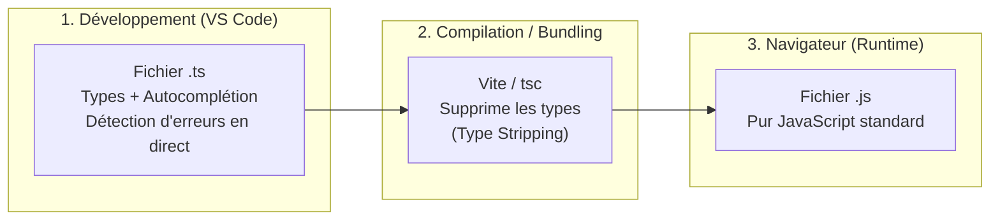

# Introduction à TypeScript

Ce cours présente les fondamentaux de **TypeScript**, son rôle dans l'écosystème web moderne, sa complémentarité avec **JavaScript**, et comment il sécurise le développement frontend en équipe.

```bash
# Création d'un projet Vite avec template TypeScript Vanilla
npm create vite@latest mon-projet-js -- --template vanilla-ts
```
---

## 1. Qu'est-ce que TypeScript ?

Créé par Microsoft en 2012 (conçu par Anders Hejlsberg, le créateur de C#), **TypeScript** est un **sur-ensemble typé (*superset*) de JavaScript**.

> [!IMPORTANT] Règle d'or de TypeScript
> **Le navigateur ne sait PAS exécuter de TypeScript.**  
> Chrome, Firefox, Safari ou Node.js ne comprennent que le **JavaScript pur**.  
> TypeScript n'existe que **pendant la phase de développement** (dans votre éditeur VS Code) et **pendant la phase de compilation**. À l'exécution, tous les types ont disparu !



---

## 2. Pourquoi utiliser TypeScript ?

En JavaScript standard, le typage est **dynamique et faible** : une variable peut changer de type à tout moment sans avertissement.

### Le problème en JavaScript pur :
```javascript
function calculerDistance(pointA, pointB) {
    return Math.hypot(pointB.x - pointA.x, pointB.y - pointA.y);
}

// 💥 En JavaScript, ceci s'exécute sans erreur dans l'éditeur, 
// mais produira NaN ou un crash dans le navigateur au clic de l'utilisateur :
calculerDistance("Paris", 42);
```

### La solution en TypeScript :
```typescript
function calculerDistance(pointA: Point, pointB: Point): number {
    return Math.hypot(pointB.x - pointA.x, pointB.y - pointA.y);
}

// ❌ VS Code souligne en ROUGE immédiatement avant même d'ouvrir le navigateur :
// "Argument of type 'string' is not assignable to parameter of type 'Point'."
calculerDistance("Paris", 42); 
```

### Les 3 bénéfices majeurs :
1. **Zéro bug bête en production :** Détection des fautes de frappe (`user.prenom` au lieu de `user.nom`), des oublis de paramètres et des passages de `null`/`undefined`.
2. **Autocomplétion puissante (IntelliSense) :** En tapant `monObjet.`, l'éditeur liste exactement les propriétés et méthodes disponibles avec leur documentation.
3. **Refactorisation sans peur :** Si vous renommez une méthode, TypeScript met à jour (ou signale) instantanément tous les fichiers du projet qui l'utilisent.

---

## 3. Les Types de Base

En TypeScript, on annote une variable ou un paramètre en ajoutant `: Type` après son nom :

```typescript
// 1. Types primitifs
let nom: string = "Neo";
let age: number = 25;
let estConnecte: boolean = true;

// 2. Tableaux (deux syntaxes équivalentes)
let notes: number[] = [12, 15, 18];
let prenoms: Array<string> = ["Alice", "Bob"];

// 3. Types spéciaux
let valeurInconnue: unknown; // Plus sécurisé que 'any'
let identifiant: string | number; // Type Union : peut être un texte OU un nombre

// 4. Fonctions (typage des paramètres et de la valeur de retour)
function saluer(prenom: string): string {
    return `Bonjour ${prenom}`;
}

// void : la fonction ne retourne rien
function loggerMessage(msg: string): void {
    console.log(msg);
}
```

> [!TIP] L'Inférence de Type (Type Inference)
> TypeScript est intelligent : si vous écrivez `let compteur = 0;`, TypeScript devine automatiquement que c'est un `number`. Il est inutile de surcharger le code en écrivant `: number` partout !

---

## 4. Les Interfaces : Le Contrat avec vos Données (et Symfony !)

Une **`interface`** définit la structure (*la forme*) qu'un objet doit respecter.

C'est l'équivalent frontend d'un **DTO** ou du miroir d'une **Entité Symfony** :

```typescript
// Définition du contrat
interface Film {
    id: number;
    titre: string;
    annee: number;
    synopsis?: string; // Le '?' signifie que la propriété est optionnelle
}

// Utilisation lors d'un appel API (ex: API Symfony)
async function getFilms(): Promise<Film[]> {
    const reponse = await fetch('http://127.0.0.1:8000/api/films');
    const films: Film[] = await reponse.json();
    return films;
}

// L'éditeur autocomplète parfaitement chaque propriété :
const premierFilm = (await getFilms())[0];
console.log(premierFilm.titre); // ✅ Valide
// console.log(premierFilm.realisateur); // ❌ Erreur : n'existe pas sur l'interface Film !
```

---

## 5. Les Classes en TypeScript (Comparatif avec le JavaScript prototypal)

Dans les chapitres précédents, nous avons vu comment concevoir des classes et de l'héritage avec les prototypes JavaScript (`Point`, `Polygone`, `Triangle`).

Regardez comme TypeScript simplifie et sécurise ce code :

### Exemple : La classe `Point`

```typescript
// src/assets/point.ts
export default class Point {
    // Déclaration explicite des propriétés et de leur type
    public x: number;
    public y: number;

    constructor(x: number, y: number) {
        this.x = x;
        this.y = y;
    }

    toString(): string {
        return `(${this.x}, ${this.y})`;
    }

    // Le paramètre doit obligatoirement être un Point, et le retour un nombre !
    calculerDistance(autrePoint: Point): number {
        const dx = autrePoint.x - this.x;
        const dy = autrePoint.y - this.y;
        return Math.hypot(dx, dy);
    }
}
```

### Exemple : L'héritage avec `Triangle extends Polygone`

```typescript
// src/assets/triangle.ts
import Point from "./point";
import Polygone from "./polygone";

export default class Triangle extends Polygone {
    constructor(p1: Point, p2: Point, p3: Point) {
        // En TS, 'super' remplace le vieux 'Polygone.call(this, [p1, p2, p3])'
        super([p1, p2, p3]);
    }

    // Calcul d'aire par la Formule de Héron
    calculerAire(): number {
        const [p1, p2, p3] = this.points;
        const a = p1.calculerDistance(p2);
        const b = p2.calculerDistance(p3);
        const c = p3.calculerDistance(p1);

        const s = this.calculerPerimetre() / 2;
        return Math.sqrt(s * (s - a) * (s - b) * (s - c));
    }
}
```

---

## 6. Démarrer un Projet TypeScript avec Vite

Grâce à **Vite**, créer et faire tourner un projet TypeScript ne nécessite que 3 commandes dans votre terminal :

```bash
# 1. Créer le projet avec le template officiel TypeScript
npm create vite@latest mon-projet-ts -- --template vanilla-ts

# 2. Entrer dans le dossier et installer les dépendances
cd mon-projet-ts
npm install

# 3. Lancer le serveur de développement avec rechargement instantané
npm run dev
```

### Fichiers clés générés :
- `tsconfig.json` : Le fichier de configuration du compilateur TypeScript (règles strictes, version cible ECMAScript).
- `src/main.ts` : Votre point d'entrée TypeScript (remplace `main.js`).
- `index.html` : Charge directement `<script type="module" src="/src/main.ts"></script>`.

---

## 7. Résumé : JavaScript vs TypeScript

| Critère | JavaScript | TypeScript |
| :--- | :--- | :--- |
| **Typage** | Dynamique (au moment où le code s'exécute) | Statique (au moment où on tape dans l'éditeur) |
| **Détection des erreurs** | Tardive (dans le navigateur, au crash) | Immédiate (souligné en rouge dans VS Code) |
| **Exécution** | Directe dans le navigateur et Node.js | Doit être transpilé en JavaScript d'abord |
| **Fichiers** | `.js` | `.ts` |
| **Utilité principale** | Scripts rapides, maquettes simples | Applications d'entreprise, projets d'équipe, frameworks (Angular, Vue, React) |
