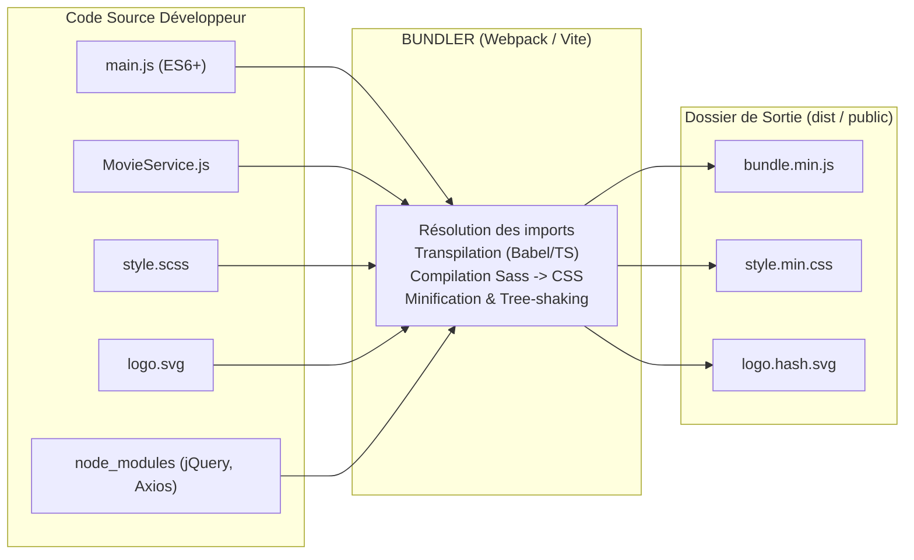
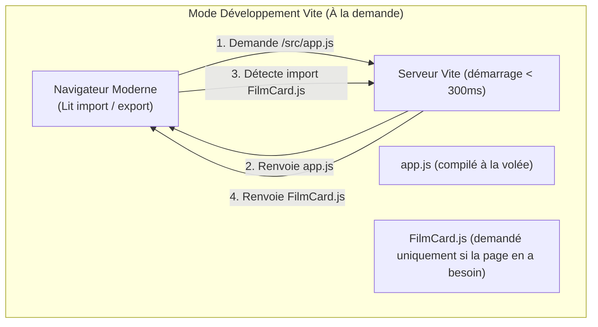

# Les Bundlers : Vite et Webpack

Ce cours présente le rôle des **bundlers** (outils de regroupement et de compilation) dans l'écosystème web moderne, compare les deux outils majeurs de l'industrie (**Webpack** et **Vite**), et explique leur intégration dans des architectures professionnelles (notamment avec **Symfony**).

---

## 1. Prérequis Indispensable : Installation de Node.js et npm

Avant de pouvoir utiliser un bundler comme Vite ou Webpack, vous devez disposer d'un environnement d'outillage JavaScript sur votre machine.

### 1.1 Qu'est-ce que npm ?
- **`npm` (Node Package Manager)** est à la fois le plus grand registre de bibliothèques logicielles au monde et l'outil en ligne de commande permettant de télécharger, installer et mettre à jour des dépendances dans vos projets.
- **Règle fondamentale :** `npm` ne s'installe **pas séparément**. Il est automatiquement fourni avec l'environnement d'exécution **Node.js**.

---

### 1.2 Comment installer Node.js et npm ?

#### Méthode 1 : Téléchargement officiel (Le plus simple)
1. Rendez-vous sur le site officiel : [nodejs.org](https://nodejs.org/).
2. Téléchargez toujours la version **LTS (Long Term Support)**, gage de stabilité en entreprise.
3. Lancez l'installateur et suivez les étapes par défaut (l'intégration de `npm`, `npx` et l'ajout au `PATH` sont cochés par défaut).

#### Méthode 2 : En ligne de commande (Gestionnaires de paquets OS)
```bash
# Sur Windows (via winget dans PowerShell) :
winget install OpenJS.NodeJS.LTS

# Sur macOS (via Homebrew) :
brew install node

# Sur Linux (Ubuntu / Debian via NodeSource) :
curl -fsSL https://deb.nodesource.com/setup_lts.x | sudo -E bash -
sudo apt install -y nodejs
```

#### Méthode 3 : Gestionnaire de versions (Recommandé en entreprise)
Pour travailler sur plusieurs projets nécessitant des versions différentes de Node.js, les professionnels utilisent un gestionnaire de versions comme **`nvm`** (Node Version Manager) ou **`fnm`** (Fast Node Manager) :
```bash
nvm install --lts
nvm use --lts
```

---

### 1.3 Vérifier que l'installation a réussi

Ouvrez un nouveau terminal (PowerShell, bash, zsh ou invite de commandes) et tapez :

```bash
# Vérifier la version du moteur Node.js
node -v
# Exemple de sortie : v20.12.0 ou supérieur

# Vérifier la version du gestionnaire npm
npm -v
# Exemple de sortie : 10.5.0 ou supérieur

# Vérifier l'exécuteur npx
npx -v
```

> [!NOTE] Rappel : La différence entre `npm` et `npx`
> - **`npm` (Manager) :** Permet d'installer des paquets et de gérer vos dépendances dans `package.json` et `node_modules/` (ex: `npm install jquery`).
> - **`npx` (Execute) :** Permet d'exécuter un binaire ou une commande directement sans l'installer de façon permanente sur votre machine (ex: `npx create-vite`).

---

## 2. Pourquoi avons-nous besoin de Bundlers ?

À l'origine du Web, pour ajouter des scripts JavaScript et du style sur une page, on empilait les balises dans le fichier HTML :

```html
<!-- L'enfer des balises script (Script Tag Hell) -->
<link rel="stylesheet" href="bootstrap.css">
<link rel="stylesheet" href="style.css">
<script src="jquery.js"></script>
<script src="plugin.js"></script>
<script src="utils.js"></script>
<script src="app.js"></script>
```

### 2.1 Les limites historiques de cette approche
1. **Ordre de chargement critique :** Si `plugin.js` s'exécute avant `jquery.js`, l'application plante.
2. **Pollution du scope global :** Toutes les variables et fonctions étaient déclarées sur l'objet global `window`, entraînant des conflits de noms accidentels.
3. **Multiplication des requêtes HTTP :** Charger 40 fichiers JS/CSS distincts ralentissait considérablement le chargement des pages.
4. **Incompatibilité avec npm :** Les navigateurs ne savent pas interpréter nativement `import $ from 'jquery'` en allant chercher dans le dossier `node_modules/`.

### 2.2 Le rôle d'un Bundler moderne
Un **bundler** prend l'ensemble des fichiers sources d'un projet (JavaScript moderne, TypeScript, CSS, Sass, images), analyse leurs relations pour construire un **graphe de dépendances** (*Dependency Graph*), et génère un ensemble de fichiers optimisés, minifiés et prêts pour la production.



---

## 3. Webpack : Le Pionnier et Géant Historique

Sorti en 2012, **Webpack** a révolutionné le développement frontend et reste omniprésent dans les projets d'entreprise et les architectures historiques.

### 3.1 Comment fonctionne Webpack ?
Avant de servir le moindre fichier au navigateur en mode développement, Webpack **parcourt l'intégralité du projet**, lit tous les fichiers importés et génère un gros bundle en mémoire.

### 3.2 Les 4 Piliers de configuration (`webpack.config.js`)

Webpack repose sur un fichier de configuration centralisé définissant 4 concepts fondamentaux :

```javascript
// webpack.config.js (Exemple simplifié)
const path = require('path');
const HtmlWebpackPlugin = require('html-webpack-plugin');

module.exports = {
    // 1. ENTRY : Le point d'entrée de l'application
    entry: './src/index.js',

    // 2. OUTPUT : Où écrire les fichiers finaux
    output: {
        path: path.resolve(__dirname, 'dist'),
        filename: 'bundle.[contenthash].js', // Hash pour le cache busting
        clean: true // Vide le dossier dist avant chaque build
    },

    // 3. LOADERS : Règles de transformation pour les fichiers non-JS
    module: {
        rules: [
            {
                test: /\.js$/,
                exclude: /node_modules/,
                use: { loader: 'babel-loader' } // Transpilation pour anciens navigateurs
            },
            {
                test: /\.s[ac]ss$/i,
                use: ['style-loader', 'css-loader', 'sass-loader'] // Sass -> CSS -> Injecté dans le DOM
            }
        ]
    },

    // 4. PLUGINS : Actions complexes sur l'ensemble du bundle
    plugins: [
        new HtmlWebpackPlugin({ template: './src/index.html' })
    ]
};
```

### 3.3 Webpack dans l'écosystème Symfony : **Webpack Encore**
Pour éviter aux développeurs PHP d'écrire des configurations Webpack complexes, Symfony a créé **Webpack Encore**. C'est une surcouche simplifiée en JavaScript avec une API fluide :

```javascript
// webpack.config.js avec Symfony Webpack Encore
const Encore = require('@symfony/webpack-encore');

Encore
    .setOutputPath('public/build/')
    .setPublicPath('/build')
    .addEntry('app', './assets/app.js')
    .enableSassLoader()
    .autoProvidejQuery() // Expose automatiquement $ et jQuery
    .enableSingleRuntimeChunk();

module.exports = Encore.getWebpackConfig();
```

---

## 4. Vite : La Révolution Moderne

Créé par **Evan You** (l'auteur de Vue.js), **Vite** (*"rapide"* en français) est devenu en quelques années le standard de facto pour les nouveaux projets web.

### 4.1 Pourquoi Vite a-t-il été créé ?
Sur de gros projets (plusieurs milliers de modules), Webpack mettait **plusieurs dizaines de secondes** à démarrer le serveur local, et chaque modification de code mettait 2 à 5 secondes à s'afficher à l'écran.

### 4.2 L'Architecture innovante de Vite

Vite divise le problème en deux modes distincts :

#### 1. En Développement (Vitesse quasi instantanée) :
- Vite exploite les **ES Modules natifs** (`<script type="module">`) directement compris par les navigateurs modernes.
- **Pas de bundling préalable !** Le serveur de dev démarre en **quelques millisecondes**.
- Quand vous ouvrez la page, le navigateur demande `app.js`. Si `app.js` importe `MovieService.js`, le navigateur fait une requête HTTP pour demander `MovieService.js` à la volée.
- Les dépendances lourdes issues de `node_modules` (comme jQuery ou lodash) sont pré-compilées en amont avec **esbuild** (un moteur écrit en langage **Go**, 10 à 100 fois plus rapide que les outils écrits en JS).



#### 2. En Production (Performance maximale) :
- En production, faire des centaines de petites requêtes HTTP pour chaque module serait inefficace.
- Vite utilise **Rollup** pour regrouper le code, éliminer le code mort (*Tree Shaking*) et minifier les assets dans un dossier `dist/`.

---

## 5. Comparatif Face-à-Face : Webpack vs Vite

| Critère | Webpack | Vite |
| :--- | :--- | :--- |
| **Philosophie en Dev** | Assemble tout le projet avant de servir | Sert les modules natifs (ESM) à la volée |
| **Vitesse de démarrage dev** | Lente (plusieurs secondes à minutes) | **Instantanée** (< 300 ms) |
| **Vitesse de mise à jour (HMR)** | Décroît quand le projet grossit | **Constante**, quelle que soit la taille du projet |
| **Outil de compilation de build** | Moteur JavaScript interne | **esbuild (Go)** en dev + **Rollup** en prod |
| **Complexité de configuration** | Élevée (*"Webpack Fatigue"*) | **Minimale** (fonctionne out-of-the-box sans config) |
| **Point d'entrée principal** | Fichier JavaScript (`entry: index.js`) | Fichier HTML (`index.html`) |
| **Maturité & Écosystème** | Historique, plugins pour chaque cas rare | Moderne, ultra dynamique, standard actuel |
| **Usage recommandé (2026)** | Maintenance de projets legacy / anciens Symfony | **Nouveaux projets** (Vanilla, React, Vue, Symfony récent) |

---

## 6. Vocabulaire Technique Indispensable

### 1. HMR (*Hot Module Replacement*)
Mécanisme permettant d'injecter une modification de code (JS ou CSS) dans le navigateur **sans recharger la page entière**. Vous modifiez le style d'une modale, elle s'actualise en direct sans perdre les données que vous veniez de taper dans le formulaire.

### 2. *Tree Shaking* (Secouage d'arbre)
Algorithme d'optimisation qui analyse les `import` et `export` pour **retirer automatiquement le code mort**.
*Exemple :* Si vous importez une seule fonction d'une bibliothèque de 500 fonctions, le bundler n'embarquera que cette unique fonction dans le bundle final.

### 3. *Code Splitting* (Découpage de code)
Technique consistant à diviser l'application en plusieurs petits bundles chargés à la demande (*lazy loading*), par exemple un bundle pour la page d'accueil et un bundle séparé pour le panneau d'administration.

### 4. *Source Maps*
Fichiers (`.map`) reliant le code minifié et compilé exécuté en production à votre code source d'origine. Si une erreur survient en production à la ligne 1 du fichier minifié, la console affiche la ligne exacte dans votre fichier source d'origine.

---

## 7. Tutoriel Pratique : Démarrer un projet avec Vite

Pour expérimenter immédiatement en TP, lancez dans votre terminal :

### Étape 1 : Créer le projet
```bash
# Création d'un projet Vite avec template JavaScript Vanilla
npm create vite@latest mon-projet-js -- --template vanilla
```

### Étape 2 : Installer et lancer
```bash
cd mon-projet-js
npm install
npm run dev
```
Le terminal affiche une URL locale (ex: `http://localhost:5173/`). Ouvrez-la : le serveur est prêt instantanément !

### Étape 3 : Structure du projet Vite
```text
mon-projet-js/
├── index.html        <-- Point d'entrée principal (contient <script type="module" src="/main.js">)
├── main.js           <-- Point d'entrée JavaScript
├── style.css         <-- Styles importables directement dans main.js : import './style.css'
├── package.json      <-- Dépendances et scripts
└── vite.config.js    <-- Fichier de configuration optionnel
```

### Étape 4 : Compiler pour la production
```bash
npm run build
```
Vite génère un dossier `dist/` contenant le HTML, le JS minifié et le CSS optimisé, prêts à être déployés sur un serveur web (Apache, Nginx, etc.).

---

## 8. Lien avec Symfony : Vite ou Webpack Encore ?

Dans le cadre de votre projet Full-Stack Symfony :

1. **Approche historique (Encore) :** Utilise `symfony/webpack-encore-bundle`. Très documenté, mais plus lourd.
2. **Approche moderne (Vite) :** De plus en plus de projets Symfony utilisent le bundle officiel de la communauté : [`pentatrion/vite-bundle`](https://github.com/lhapaipai/symfony-vite-bundle).
   - Dans vos templates Twig, vous chargez les scripts en une seule ligne :
     ```twig
     {{ vite_entry_script_tags('app') }}
     {{ vite_entry_link_tags('app') }}
     ```
   - Vous bénéficiez du rechargement instantané de Vite tout en développant votre backend Symfony !

---

## 9. Étude de Cas Concrète : Packager notre projet Géométrie avec Vite

Prenons le projet orienté objet développé dans le dossier `priv_brouillon_cours/` (`Point`, `Polygone`, `Triangle`, `Quadrilatere` avec la formule de Héron et le Canvas interactif).

### 9.1 Le Problème Initial (Sans Bundler)
Sans outil de build, nous devions inclure manuellement chaque script dans `index.html` en respectant un **ordre strict de dépendance** :
```html
<!-- Sans Bundler : fragile et manuel -->
<script src="Point.js"></script>
<script src="Polygone.js"></script>       <!-- Doit être APRÈS Point -->
<script src="Triangle.js"></script>       <!-- Doit être APRÈS Polygone -->
<script src="Quadrilatere.js"></script>   <!-- Doit être APRÈS Triangle et Polygone -->
<script src="app.js"></script>
```

#### Les inconvénients majeurs :
1. **Erreur d'ordre fatale :** Si un développeur déplace `Triangle.js` avant `Polygone.js`, l'application plante (`ReferenceError: Polygone is not defined`).
2. **Pollution du scope global :** Toutes les classes sont déposées sur l'objet global `window`.
3. **Bricolage d'exportation :** Pour que les fichiers fonctionnent à la fois dans Node.js (`require`) et dans le navigateur (`window`), nous devions écrire du code défensif verbeux :
   ```javascript
   const Point = typeof require !== 'undefined' ? require('./Point') : window.Point;
   if (typeof module !== 'undefined' && module.exports) { module.exports = Point; }
   ```

---

### 9.2 La Modernisation avec les ES Modules et Vite

Grâce à Vite et aux **ES Modules (`import` / `export`)**, le code devient propre, standard et modulaire.

#### 1. Fichiers sources modulaires :
Dans `Point.js` :
```javascript
function Point(x, y) { ... }
Point.prototype.distance = function(autrePoint) { ... };

export default Point; // Export propre
```

Dans `Triangle.js` :
```javascript
import Point from './Point.js';
import Polygone from './Polygone.js';

function Triangle(p1, p2, p3, nom) {
    Polygone.call(this, [p1, p2, p3], nom);
}
Triangle.prototype = Object.create(Polygone.prototype);
Triangle.prototype.constructor = Triangle;
Triangle.prototype.calculerAire = function() { ... }; // Formule de Héron

export default Triangle;
```

Dans `Quadrilatere.js` :
```javascript
import Point from './Point.js';
import Polygone from './Polygone.js';
import Triangle from './Triangle.js';

function Quadrilatere(p1, p2, p3, p4, nom) {
    Polygone.call(this, [p1, p2, p3, p4], nom);
}
Quadrilatere.prototype = Object.create(Polygone.prototype);
Quadrilatere.prototype.constructor = Quadrilatere;
Quadrilatere.prototype.calculerAire = function() {
    // Réutilise le module Triangle pour décomposer en 2 sous-triangles de Héron !
    const t1 = new Triangle(p1, p2, p3);
    const t2 = new Triangle(p1, p3, p4);
    return t1.calculerAire() + t2.calculerAire();
};

export default Quadrilatere;
```

#### 2. Le point d'entrée unique dans `index.html` :
Fini les 5 balises `<script>` manuelles ! Une seule balise suffit :
```html
<!-- index.html -->
<script type="module" src="./app.js"></script>
```

#### 3. Résolution automatique du graphe par Vite :
Vite analyse `app.js` et découvre tout seul le graphe de dépendance :
```text
app.js
 ├── Quadrilatere.js
 │    ├── Triangle.js
 │    │    ├── Polygone.js
 │    │    │    └── Point.js
 │    │    └── Point.js
 │    ├── Polygone.js
 │    └── Point.js
 ├── Triangle.js
 ├── Polygone.js
 └── Point.js
```
Vite garantit que `Point` sera toujours chargé avant `Polygone`, et `Polygone` avant `Triangle`, sans aucune intervention humaine !

---

### 9.3 Configuration du projet avec `package.json`

Dans `priv_brouillon_cours/package.json` :
```json
{
  "name": "geometrie-prototypes-vite",
  "version": "1.0.0",
  "type": "module",
  "scripts": {
    "dev": "vite",
    "build": "vite build",
    "preview": "vite preview",
    "test": "node main.js"
  },
  "devDependencies": {
    "vite": "^5.4.0"
  }
}
```

### 9.4 En Pratique pour vos Étudiants

1. **Lancer le serveur de développement Vite :**
   ```bash
   npx vite
   # ou npm run dev
   ```
   - Le serveur démarre en **~150 ms**.
   - Ouvrez l'URL locale : le Canvas 2D s'affiche et calcule les périmètres et aires de Héron en temps réel.
   - **Test du HMR (Hot Module Replacement) :** Modifiez la couleur du tracé ou les coordonnées d'un point dans `app.js` ➔ la figure se met à jour dans le navigateur **instantanément sans rechargement de page**.

2. **Générer le bundle de production :**
   ```bash
   npx vite build
   # ou npm run build
   ```
   Vite utilise Rollup pour générer le dossier `dist/` :
   - Tous les fichiers JS (`Point`, `Polygone`, `Triangle`, `Quadrilatere`, `app`) sont fusionnés en un seul fichier `dist/assets/index-[hash].js` minifié et ultra optimisé.
   - Le code mort inutilisé est éliminé (*Tree-Shaking*).
   - Les variables locales sont renommées pour occuper le moins d'octets possible.

