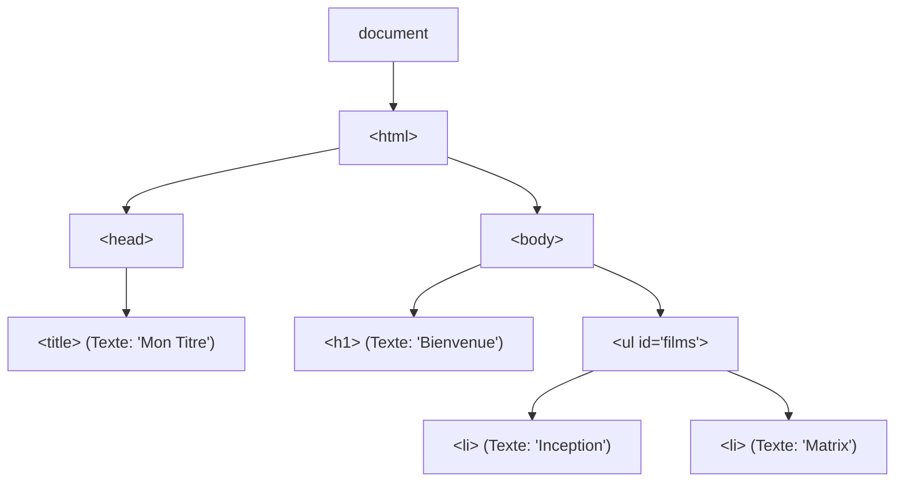
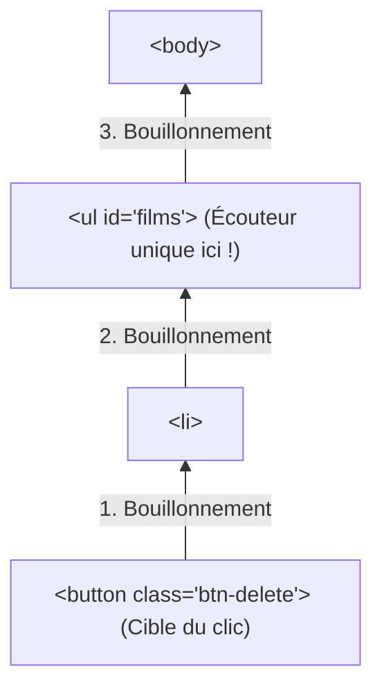

# Manipulation du DOM en Vanilla JS

## 1. Qu'est-ce que le DOM ?

Le **DOM (Document Object Model)** est une interface de programmation (API) pour les documents HTML et XML.

Lorsque le navigateur télécharge une page HTML, son moteur d'analyse (*parser*) construit une arborescence d'objets en mémoire : **l'arbre DOM**.



- **Fichier HTML :** Texte brut statique sur le disque ou reçu du serveur.
- **Arbre DOM :** Représentation vivante et dynamique modifiable en temps réel par JavaScript via l'objet global `document`.

### 1.1 Attendre le chargement du DOM

Si votre script JavaScript tente d'accéder à un élément HTML avant que le navigateur ne l'ait lu, il obtiendra `null`.

#### La solution moderne (recommandée)
Placez votre balise `<script>` dans le `<head>` avec l'attribut `defer` (ou `type="module"`) :
```html
<head>
    <script src="app.js" defer></script>
</head>
```
L'attribut `defer` télécharge le script en arrière-plan sans bloquer l'affichage, et l'exécute automatiquement une fois le DOM entièrement prêt.

#### L'événement `DOMContentLoaded`
Si vous ne maîtrisez pas l'inclusion du script :
```javascript
document.addEventListener('DOMContentLoaded', () => {
    console.log("Le DOM est entièrement construit et prêt à être manipulé !");
});
```

---

## 2. Sélectionner des éléments du DOM

Depuis l'introduction des Selectors API (CSS), la sélection d'éléments en Vanilla JS est aussi simple et puissante qu'avec jQuery.

### 2.1 Les méthodes modernes universelles

#### 1. `document.querySelector(selecteurCSS)`
Retourne le **premier élément** correspondant au sélecteur CSS, ou `null` si aucun élément ne correspond :
```javascript
const titre = document.querySelector('#titre-principal'); // Par ID
const premierBouton = document.querySelector('.btn-action'); // Par classe
const emailInput = document.querySelector('input[type="email"]'); // Par attribut
const sousTitre = document.querySelector('header > p.description'); // Combinateur CSS
```

#### 2. `document.querySelectorAll(selecteurCSS)`
Retourne **tous les éléments** correspondants sous forme d'une `NodeList` (collection d'éléments) :
```javascript
const tousLesFilms = document.querySelectorAll('.film-item');

// Une NodeList possède la méthode .forEach() :
tousLesFilms.forEach(film => {
    console.log(film.textContent);
});

// Pour la convertir en véritable Array JavaScript (afin d'utiliser map, filter, etc.) :
const tableauFilms = Array.from(tousLesFilms);
// ou avec le spread operator :
const tableauFilms2 = [...tousLesFilms];
```

### 2.2 Sélection contextuelle (Recherche dans un sous-arbre)
On peut appeler `querySelector` sur n'importe quel élément existant, pour restreindre la recherche à ses descendants :
```javascript
const carteFilm = document.querySelector('.carte-active');
// Cherche le bouton .btn-supprimer UNIQUEMENT à l'intérieur de cette carte :
const btnSuppr = carteFilm.querySelector('.btn-supprimer');
```

---

## 3. Traverser le DOM (*DOM Traversal*)

Pour naviguer de nœud en nœud sans refaire une sélection globale :

| Direction | Propriété / Méthode | Description |
| :--- | :--- | :--- |
| **Vers le haut (Parent)** | `el.parentElement` | Parent direct de l'élément |
| | `el.closest(selecteurCSS)` | Remonte les ancêtres et retourne le 1er correspondant au sélecteur |
| **Vers le bas (Enfants)** | `el.children` | Collection des enfants HTML directs |
| | `el.firstElementChild` | Premier enfant HTML |
| | `el.lastElementChild` | Dernier enfant HTML |
| **Latéral (Frères/Sœurs)** | `el.nextElementSibling` | Élément frère suivant |
| | `el.previousElementSibling` | Élément frère précédent |

> [!TIP] La méthode indispensable : `closest()`
> `el.closest('.carte')` teste d'abord l'élément lui-même, puis remonte la hiérarchie parent par parent jusqu'à trouver un élément correspondant au sélecteur CSS. C'est l'équivalent direct de `$el.closest()` en jQuery, capital pour la délégation d'événements.

---

## 4. Modifier le Contenu et les Textes

### 4.1 `textContent` vs `innerHTML`

```javascript
const boite = document.querySelector('#ma-boite');

// 1. textContent : Modifie ou lit uniquement le texte brut
boite.textContent = 'Bonjour tout le monde !';
// Sécurisé : si le texte contient des balises <script> ou <b>, elles ne seront PAS interprétées.

// 2. innerHTML : Injecte du code HTML interprété
boite.innerHTML = 'Bienvenue sur <strong>Symfony & JS</strong> !';
```

> [!CAUTION] Danger XSS avec `innerHTML`
> N'injectez **JAMAIS** directement une donnée saisie par un utilisateur ou une API non filtrée avec `innerHTML` ! Utilisez `textContent` ou `createElement` pour éviter les injections de code malveillant (Cross-Site Scripting).

### 4.2 Valeurs de formulaires : `.value`
Pour les éléments de saisie (`input`, `textarea`, `select`), on utilise la propriété `.value` :
```javascript
const inputNom = document.querySelector('#nom-input');

// Lire la saisie
console.log(inputNom.value);

// Modifier la saisie
inputNom.value = 'Inception';
```

---

## 5. Modifier les Classes, Attributs et Styles

### 5.1 Manipulation des classes CSS : `classList`

La propriété `classList` fournit une API simple et intuitive :
```javascript
const alerte = document.querySelector('.alerte');

alerte.classList.add('visible', 'succes'); // Ajoute une ou plusieurs classes
alerte.classList.remove('invisible');      // Supprime une classe
alerte.classList.toggle('actif');          // Bascule (ajoute si absente, supprime si présente)
const estActif = alerte.classList.contains('actif'); // true ou false
alerte.classList.replace('erreur', 'succes'); // Remplace une classe par une autre
```

### 5.2 Attributs HTML et `dataset` (data-*)

```javascript
const lien = document.querySelector('#mon-lien');

// Gestion classique des attributs
lien.setAttribute('href', 'https://symfony.com');
lien.setAttribute('target', '_blank');
console.log(lien.getAttribute('href'));
lien.removeAttribute('target');
console.log(lien.hasAttribute('disabled'));

// Attributs personnalisés HTML5 data-* via la propriété dataset
// HTML : <div id="film" data-id="42" data-date-sortie="2010"></div>
const filmEl = document.querySelector('#film');
console.log(filmEl.dataset.id);          // "42"
console.log(filmEl.dataset.dateSortie);  // "2010" (converti automatiquement en camelCase !)
filmEl.dataset.note = "5";               // Ajoute data-note="5" dans le HTML
```

### 5.3 Styles CSS en ligne : `.style`

Les propriétés CSS s'écrivent en **camelCase** :
```javascript
const carte = document.querySelector('.carte');

carte.style.backgroundColor = '#1e293b'; // Au lieu de background-color
carte.style.fontSize = '18px';           // Toujours préciser l'unité
carte.style.display = 'none';            // Masquer

// Pour réinitialiser un style en ligne et laisser le fichier CSS reprendre le relais :
carte.style.display = '';
```

---

## 6. Créer, Insérer et Supprimer des Éléments

### 6.1 Le cycle complet : `createElement` ➔ Configuration ➔ `append`

```javascript
// 1. Création de l'élément en mémoire (non encore visible sur la page)
const nouveauFilm = document.createElement('li');

// 2. Configuration de ses propriétés
nouveauFilm.classList.add('film-item');
nouveauFilm.dataset.id = '101';
nouveauFilm.textContent = 'Oppenheimer (2023)';

// Création d'un bouton enfant
const btnSuppr = document.createElement('button');
btnSuppr.textContent = 'Supprimer';
btnSuppr.classList.add('btn-delete');
nouveauFilm.append(btnSuppr);

// 3. Insertion dans le DOM parent
const listeFilms = document.querySelector('#liste-films');
listeFilms.append(nouveauFilm); // Ajout à la fin (ou .prepend() pour le début)
```

### 6.2 Méthodes modernes d'insertion et de suppression

```javascript
const conteneur = document.querySelector('#conteneur');
const element = document.querySelector('#element');

// Insertion relative
element.before(autreElement); // Insère avant 'element' (en tant que frère)
element.after(autreElement);  // Insère après 'element' (en tant que frère)

// Vider un conteneur proprement
conteneur.replaceChildren(); // Supprime tous les enfants en une opération optimisée

// Supprimer un élément du DOM
element.remove(); // Supprime directement l'élément lui-même
```

### 6.3 Les balises `<template>` pour des composants réutilisables

Au lieu d'écrire de longues chaînes de concaténation, utilisez la balise HTML `<template>` :

```html
<!-- Dans votre fichier HTML -->
<template id="film-template">
    <li class="film-card">
        <h4 class="film-title"></h4>
        <span class="film-year"></span>
        <button class="btn-delete">Supprimer</button>
    </li>
</template>
```

```javascript
// Dans votre fichier JS :
const template = document.querySelector('#film-template');

function creerCarteFilm(titre, annee) {
    // Clone le contenu du template en profondeur (true)
    const clone = template.content.cloneNode(true);

    clone.querySelector('.film-title').textContent = titre;
    clone.querySelector('.film-year').textContent = `(${annee})`;

    return clone;
}

// Injection :
document.querySelector('#liste-films').append(creerCarteFilm('Matrix', 1999));
```

---

## 7. Gestion des Événements (*Event Handling*)

### 7.1 `addEventListener` et l'objet `Event`

```javascript
const bouton = document.querySelector('#btn-valider');

bouton.addEventListener('click', (event) => {
    console.log("Type d'événement :", event.type);       // "click"
    console.log("Élément cliqué :", event.target);        // Bouton cliqué
    console.log("Élément récepteur :", event.currentTarget);
});
```

### 7.2 Annuler le comportement par défaut : `preventDefault()`

Indispensable lors de la soumission d'un formulaire pour empêcher le rechargement complet de la page avant l'envoi AJAX vers Symfony :

```javascript
const form = document.querySelector('#form-ajout');

form.addEventListener('submit', (e) => {
    e.preventDefault(); // Stoppe le rechargement HTTP classique

    const titre = document.querySelector('#input-titre').value;
    console.log(`Donnée prête pour envoi API : ${titre}`);
});
```

---

## 8. La Propagation & La Délégation d'Événements

### 8.1 Mécanisme du Bouillonnement (*Event Bubbling*)

Quand un utilisateur clique sur un bouton situé dans une liste, l'événement ne s'arrête pas au bouton : il **remonte** successivement à travers tous ses parents jusqu'à la racine du document (`button` ➔ `li` ➔ `ul` ➔ `body` ➔ `document`).



### 8.2 Pourquoi la Délégation d'Événements est capitale ?

1. **Performances :** Si vous avez 500 films dans une liste, attacher 500 écouteurs consomme beaucoup de mémoire. Un seul écouteur sur le parent suffit.
2. **Éléments dynamiques :** Les films injectés plus tard via `fetch()` n'ont pas d'écouteurs attachés. Grâce à la délégation sur le parent permanent, ils fonctionnent immédiatement !

```javascript
const liste = document.querySelector('#liste-films');

// Un seul écouteur sur le parent <ul> qui existe dès le début :
liste.addEventListener('click', (event) => {
    // On vérifie si le clic (ou son origine) vient d'un bouton de suppression
    const btnSuppr = event.target.closest('.btn-delete');
    
    // Si on a cliqué sur le texte ou ailleurs dans le <li>, on ignore
    if (!btnSuppr) return;

    // Récupération de la ligne parente et suppression
    const ligneFilm = btnSuppr.closest('li');
    ligneFilm.remove();
    console.log("Film supprimé par délégation !");
});
```

---

## 9. Performance & Bonnes Pratiques

1. **Limiter les accès au DOM :** La lecture et l'écriture dans le DOM provoquent des recalculs de rendu (*Reflow / Repaint*) coûteux pour le navigateur.
   - Ne faites **pas** de `liste.append(el)` à l'intérieur d'une boucle de 1000 éléments.
   - Utilisez un **`DocumentFragment`** en mémoire, puis insérez-le en une seule fois :
     ```javascript
     const fragment = document.createDocumentFragment();
     films.forEach(film => {
         const li = document.createElement('li');
         li.textContent = film.titre;
         fragment.append(li);
     });
     // Une seule opération de peinture dans le DOM :
     liste.append(fragment);
     ```

2. **Privilégier `textContent` sur `innerHTML`** lorsqu'il s'agit d'injecter du texte pur.

3. **Mettre en cache les sélections :** Stockez les références d'éléments fréquemment accédés dans des constantes plutôt que de répéter `document.querySelector` à chaque appel.