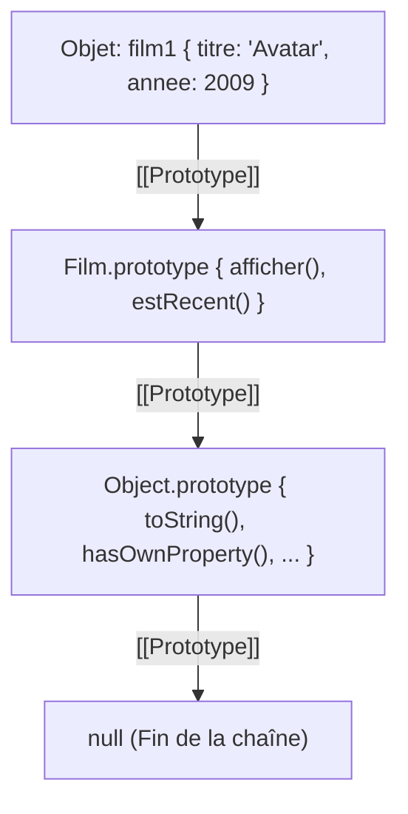

# 2. Objets, `this` et Héritage Prototypal

Ce cours aborde le cœur du modèle objet de JavaScript : la manipulation avancée des objets, le comportement contextuel du mot-clé `this`, et le paradigme d'**héritage prototypal** (spécificité fondamentale de JavaScript), ainsi que sa transcription moderne via les **Classes ES6**.

---

## 1. Les Objets en JavaScript Moderne

En JavaScript, un objet est une collection de paires clé-valeur (propriétés et méthodes).

### 1.1 Syntaxe moderne et fonctionnalités ES6+

```javascript
const statut = "disponible";

// 1. Shorthand properties (propriétés abrégées)
// 2. Computed property names (clés dynamiques)
// 3. Méthodes concises
const film = {
    titre: "Inception",
    annee: 2010,
    // Clé dynamique évaluée entre crochets :
    [statut]: true,
    // Syntaxe de méthode concise :
    afficherDetails() {
        return `${this.titre} (${this.annee})`;
    }
};

console.log(film.disponible); // true
console.log(film.afficherDetails()); // "Inception (2010)"
```

### 1.2 Destructuration & Opérateur Spread (`...`)

La déstructuration extrait facilement des propriétés, très utile lors de la réception de réponses JSON d'une API (comme Symfony) :

```javascript
// Destructuration avec valeur par défaut et renommage
const { titre, annee, realisateur = "Inconnu" } = film;
console.log(titre, annee, realisateur);

// Clonage superficiel (shallow copy) et extension avec le Spread operator
const filmAvecNote = {
    ...film,
    note: 4.8,
    statut: "en salle" // Écrase la valeur précédente
};
```

> [!WARNING] Copie superficielle vs Copie profonde
> Le spread operator `{ ...obj }` ou `Object.assign({}, obj)` ne réalise qu'une **copie superficielle** (*shallow copy*). Si l'objet contient des sous-objets ou des tableaux, leurs références restent partagées !
> Pour faire une vraie copie indépendante, utilisez l'API native moderne :
> ```javascript
> const copieProfonde = structuredClone(filmComplexe);
> ```

---

## 2. Le Mot-Clé `this` & Contexte d'Exécution

> [!IMPORTANT] Règle d'or de `this`
> En JavaScript, la valeur de `this` dans une fonction classique **ne dépend pas de l'endroit où la fonction a été déclarée**, mais de **la façon dont elle est appelée** au moment de l'exécution (*runtime context*).

Il existe 4 règles majeures pour déterminer la valeur de `this` :

### Règle 1 : Appel de méthode d'objet
Quand une fonction est appelée en tant que méthode d'un objet (`objet.methode()`), `this` fait référence à l'objet situé avant le point.

```javascript
const compte = {
    solde: 1500,
    afficherSolde() {
        console.log(`Solde : ${this.solde} €`);
    }
};

compte.afficherSolde(); // Solde : 1500 € (this === compte)
```

### Règle 2 : Appel de fonction libre (et le piège de la perte de contexte)
Si on extrait la méthode pour l'appeler de manière isolée, le lien avec l'objet est rompu :

```javascript
const fnDetachee = compte.afficherSolde;
fnDetachee(); 
// En mode non-strict : Affiche 'Solde : undefined €' (this est l'objet global window)
// En mode strict ("use strict") : TypeError: Cannot read properties of undefined (this est undefined)
```

Ce piège arrive constamment dans les **callbacks** (comme `setTimeout` ou les écouteurs d'événements) :

```javascript
const joueur = {
    pseudo: "Neo",
    saluerApresDelai() {
        setTimeout(function() {
            // Ici, la fonction anonyme est appelée par le navigateur, pas par 'joueur' !
            console.log(`Bonjour ${this.pseudo}`); // "Bonjour undefined"
        }, 500);
    }
};
joueur.saluerApresDelai();
```

### Règle 3 : Forcer le contexte avec `call()`, `apply()` et `bind()`

JavaScript permet de forcer explicitement la valeur de `this` :

```javascript
function presenter(prefixe, suffixe) {
    console.log(`${prefixe} ${this.titre} ${suffixe}`);
}

const film1 = { titre: "Gladiator" };
const film2 = { titre: "Interstellar" };

// 1. call() : Exécute immédiatement en passant this, puis les arguments un par un
presenter.call(film1, "Le film", "est un chef-d'œuvre"); // "Le film Gladiator est un chef-d'œuvre"

// 2. apply() : Même chose que call, mais les arguments sont passés sous forme de tableau
presenter.apply(film2, ["Le film", "est impressionnant"]);

// 3. bind() : NE LANCE PAS la fonction. Renvoie une NOUVELLE fonction avec this fixé définitivement
const presenterFilm1 = presenter.bind(film1, "Film :");
presenterFilm1("à voir !"); // "Film : Gladiator à voir !"
```

### Règle 4 : Les Fonctions Fléchées (*Arrow Functions*)
Les fonctions fléchées **n'ont pas leur propre `this`**. Elles capturent le `this` de la portée lexicale englobante (l'endroit où elles ont été écrites) :

```javascript
const joueurCorrige = {
    pseudo: "Neo",
    saluerApresDelai() {
        // La fonction fléchée hérite du 'this' de saluerApresDelai (qui est 'joueurCorrige')
        setTimeout(() => {
            console.log(`Bonjour ${this.pseudo}`); // "Bonjour Neo" (Fonctionne !)
        }, 500);
    }
};
joueurCorrige.saluerApresDelai();
```

> [!CAUTION] Ne JAMAIS déclarer une méthode d'objet avec une fonction fléchée
> ```javascript
> const filmBug = {
>     titre: "Titanic",
>     afficher: () => console.log(this.titre) // DANGER : this est l'objet englobant (ex: window/module) !
> };
> filmBug.afficher(); // undefined
> ```

---

## 3. L'Héritage Prototypal

JavaScript est un langage **orienté objet à base de prototypes**, et non à base de classes au sens traditionnel (comme c#, Java, C++ ou PHP).

### 3.1 Philosophie : Héritage par délégation

| POO par Classes (Java, PHP, C#)                                  | POO par Prototype (JavaScript)                                                                  |
| :--------------------------------------------------------------- | :---------------------------------------------------------------------------------------------- |
| La classe est un **moule / patron abstrait**.                    | Il n'y a **que des objets concrets**.                                                           |
| L'instance est créée par **copie** de la structure de la classe. | Un objet est relié directement à un autre objet parent.                                         |
| Les méthodes sont dupliquées ou liées statiquement.              | Si une propriété n'est pas trouvée, elle est **déléguée** au prototype en remontant une chaîne. |

### 3.2 La Chaîne de Prototypes (*Prototype Chain*)

Chaque objet possède un lien interne vers un autre objet appelé son **prototype** (noté formellement `[[Prototype]]`, accessible via `Object.getPrototypeOf(obj)` ou historiquement `__proto__`).



Lorsqu'on tente de lire `film1.toString()` :
1. Le moteur cherche `toString` directement sur `film1` ➔ *Non trouvé.*
2. Il remonte sur son prototype (`Film.prototype`) ➔ *Non trouvé.*
3. Il remonte sur le prototype suivant (`Object.prototype`) ➔ *Trouvé ! Exécution.*
4. Si la fin de la chaîne (`null`) est atteinte sans succès ➔ renvoie `undefined`.

---

## 4. Fonctions Constructeurs et l'Opérateur `new`

Avant les classes ES6, l'héritage prototypal se construisait à l'aide de **fonctions constructeurs**.

### 4.1 Définir un constructeur et enrichir son `.prototype`

```javascript
// 1. Fonction constructeur (majuscule par convention)
function Film(titre, annee) {
    // Propriétés d'instance (propres à chaque objet)
    this.titre = titre;
    this.annee = annee;
}

// 2. Ajout de méthodes sur le prototype partagé (économie de mémoire !)
Film.prototype.afficher = function() {
    return `${this.titre} sortit en ${this.annee}`;
};

Film.prototype.estRecent = function() {
    return this.annee >= 2020;
};

// 3. Instanciation avec 'new'
const film1 = new Film("Matrix", 1999);
const film2 = new Film("Dune 2", 2024);

console.log(film1.afficher());  // "Matrix sortit en 1999"
console.log(film2.estRecent()); // true

// Vérification de la chaîne de prototypes
console.log(film1 instanceof Film);   // true
console.log(film1 instanceof Object); // true
console.log(Object.getPrototypeOf(film1) === Film.prototype); // true
```

> [!NOTE] Que fait exactement l'opérateur `new` sous le capot ?
> Lorsque vous écrivez `const f = new Film("Dune", 2021)`, le moteur réalise 4 opérations :
> 1. Il crée un nouvel objet vide en mémoire : `{}`.
> 2. Il relie le prototype de cet objet au prototype de la fonction : `Object.setPrototypeOf(obj, Film.prototype)`.
> 3. Il exécute `Film` en liant `this` à ce nouvel objet : `Film.call(obj, "Dune", 2021)`.
> 4. Il retourne automatiquement ce nouvel objet.

### 4.2 Mettre en place un héritage entre prototypes (Façon ES5)

Pour créer une sous-classe (ex: `FilmSerie` qui hérite de `Film`) sans les classes modernes :

```javascript
function Serie(titre, annee, nombreSaisons) {
    // Appel du constructeur parent avec le bon this (équivalent du super())
    Film.call(this, titre, annee);
    this.nombreSaisons = nombreSaisons;
}

// Lier les prototypes : Serie.prototype hérite de Film.prototype
Serie.prototype = Object.create(Film.prototype);
// Restaurer le constructeur d'origine
Serie.prototype.constructor = Serie;

// Ajouter une méthode spécifique à Serie
Serie.prototype.detailsSerie = function() {
    return `${this.afficher()} - ${this.nombreSaisons} saisons`;
};

const arcane = new Serie("Arcane", 2021, 2);
console.log(arcane.detailsSerie()); // "Arcane sortit en 2021 - 2 saisons"
console.log(arcane instanceof Serie); // true
console.log(arcane instanceof Film);  // true (Héritage validé !)
```

---

## 5. Les Classes ES6 : Le Sucre Syntaxique Moderne

Depuis ES6 (2015), JavaScript propose la syntaxe `class`.

> [!IMPORTANT] Attention à l'illusion des Classes
> Les classes JavaScript **ne changent absolument rien** au fonctionnement interne de JavaScript ! Elles ne sont qu'un **sucre syntaxique** (*syntactic sugar*) par-dessus les fonctions constructeurs et les prototypes.
> La preuve : `typeof class Film {} === "function"`.

### 5.1 Syntaxe moderne d'une classe

```javascript
class Film {
    // Propriété privée (ES2022, préfixée par #)
    #id;

    constructor(id, titre, annee) {
        this.#id = id;
        this.titre = titre;
        this.annee = annee;
    }

    // Méthode d'instance (placée automatiquement sur Film.prototype)
    afficher() {
        return `${this.titre} (${this.annee})`;
    }

    // Getter & Setter
    get identifiant() {
        return `FILM-${this.#id}`;
    }

    // Méthode statique (attachée directement à la classe, pas aux instances)
    static comparer(filmA, filmB) {
        return filmA.annee - filmB.annee;
    }
}

const f = new Film(42, "Oppenheimer", 2023);
console.log(f.afficher());     // "Oppenheimer (2023)"
console.log(f.identifiant);    // "FILM-42"
// console.log(f.#id);         // SyntaxError: Private field '#id' must be declared in an enclosing class
```

### 5.2 Héritage moderne avec `extends` et `super`

```javascript
class Serie extends Film {
    constructor(id, titre, annee, nombreSaisons) {
        // Appel obligatoire du constructeur parent
        super(id, titre, annee);
        this.nombreSaisons = nombreSaisons;
    }

    // Surcharge de méthode (Override)
    afficher() {
        return `${super.afficher()} — Série en ${this.nombreSaisons} saisons`;
    }
}

const strangerThings = new Serie(10, "Stranger Things", 2016, 4);
console.log(strangerThings.afficher());
// "Stranger Things (2016) — Série en 4 saisons"
```

---

## 6. Cas Pratique & Synergie Symfony : Le Modèle Client

Dans votre architecture Full-Stack, les données reçues de l'API Symfony arrivent sous forme d'objets JSON bruts (sans méthodes).
L'intérêt d'une classe côté client est de **transformer ces données brutes en objets métiers riches** :

```javascript
// Modèle côté frontend consommant l'entité Symfony
class MovieModel {
    constructor(apiData) {
        this.id = apiData.id;
        this.title = apiData.title;
        this.year = parseInt(apiData.year, 10);
        this.synopsis = apiData.synopsis || "Aucun résumé disponible.";
    }

    estClassique() {
        return this.year < 2000;
    }

    toHTML() {
        return `
            <div class="movie-card" data-id="${this.id}">
                <h3>${this.title}</h3>
                <span class="badge">${this.year}</span>
                <p>${this.synopsis}</p>
                <button class="btn-delete" data-id="${this.id}">Supprimer</button>
            </div>
        `;
    }
}

// Utilisation lors de la réception des données Symfony (fetch) :
// const response = await fetch('/api/films');
// const filmsJSON = await response.json();
// const filmModels = filmsJSON.map(data => new MovieModel(data));
// filmModels.forEach(film => container.innerHTML += film.toHTML());
```

---

## 7. TP Guidé : L'héritage par prototype (Compétence Syllabus)

### Énoncé

Vous devez implémenter un système de gestion de véhicules pour une concession :
1. **Étape 1 (Sans classe, prototypes purs) :**
   - Créez une fonction constructeur `Vehicule(marque, modele, prix)`.
   - Ajoutez sur son prototype une méthode `getFiche()` qui retourne `"Marque Modele - Prix €"`.
   - Créez une fonction constructeur `VoitureElectrique(marque, modele, prix, autonomieKm)` qui hérite de `Vehicule`.
   - Liez les prototypes via `Object.create()` et vérifiez que `instanceof` fonctionne pour les deux niveaux.
2. **Étape 2 (Refactorisation ES6) :**
   - Réécrivez la même hiérarchie avec les mots-clés `class`, `extends` et `super`.
   - Comparez dans la console du navigateur : que vaut `VoitureElectrique.prototype.__proto__` dans les deux cas ? (Vous constaterez qu'ils mènent exactement au même résultat !).

---

### Prochaine étape :
➡️ **[[L'API DOM et la gestion des événements]]**
