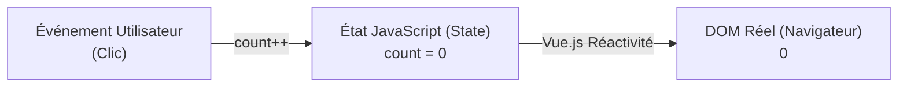
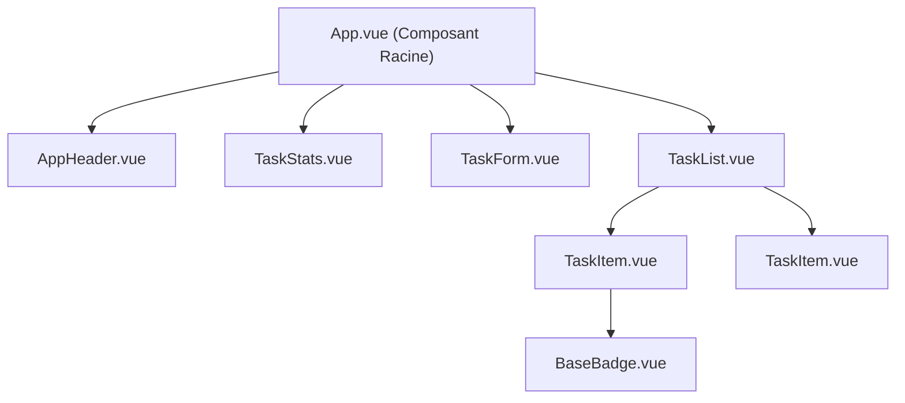
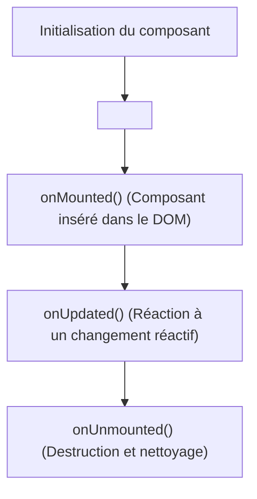

# Framework Front-End Moderne : Vue.js 3 avec Vite

Ce cours est conçu pour les étudiants de **B2 EPSI** ayant déjà assimilé les bases du JavaScript moderne (ES6+), l'héritage prototypal, la manipulation du DOM (Vanilla et jQuery) ainsi que le fonctionnement des bundlers modernes (Vite).

Il introduit le paradigme des **frameworks réactifs basés sur les composants**, explore en profondeur **Vue.js 3** avec la **Composition API (`<script setup>`)**, et s'appuie sur le projet d'exemple complet **EPSI DevTrack** situé dans le sous-dossier `priv_brouillon_cours/projet-vue-exemple/`.

---

## 1. Du DOM Impératif aux Frameworks Déclaratifs

Jusqu'à présent, pour créer une interface dynamique, nous devions manipuler le DOM de manière **impérative** :

```javascript
// Approche Impérative (Vanilla JS / jQuery) :
// On dit AU NAVIGATEUR COMMENT faire chaque manipulation pas-à-pas
const button = document.querySelector('#btn');
const counterSpan = document.querySelector('#counter');
let count = 0;

button.addEventListener('click', () => {
    count++;
    counterSpan.textContent = count; // Mise à jour MANUELLE du DOM
    if (count >= 10) {
        counterSpan.classList.add('highlight'); // Ajout MANUEL de classe
    }
});
```

### 1.1 Le problème de passage à l'échelle (Spaghetti Code)
Dès qu'une application dépasse quelques fonctionnalités, l'approche impérative pose des problèmes critiques :
1. **Désynchronisation entre état et affichage :** Si une variable change à un endroit, il faut penser à mettre à jour tous les éléments HTML concernés. En cas d'oubli, l'affichage ment à l'utilisateur.
2. **Performances :** Modifier le DOM réel de manière répétée déclenche des recalculs lourds de mise en page (*Reflow* et *Repaint*).
3. **Absence de structure modulaire :** Le HTML, le CSS et le JS sont souvent éparpillés, rendant la réutilisation de blocs d'interface très difficile.

### 1.2 Le paradigme Déclaratif et Réactif : $UI = f(\text{State})$
Avec **Vue.js**, le développeur ne modifie plus directement les balises HTML. Il modifie simplement ses **données JavaScript (l'État ou State)**, et le framework se charge de mettre à jour le DOM de manière optimale.



---

## 2. Pourquoi Vue.js 3 & Vite ?

### 2.1 La philosophie de Vue.js
Créé par Evan You, Vue est un framework **progressif** :
- **Courbe d'apprentissage douce :** Il s'appuie directement sur les standards du Web (HTML, CSS, JS).
- **Écosystème officiel robuste :** Vue Router (navigation), Pinia (gestion d'état global), DevTools officielles.
- **Performances de premier plan :** Système de réactivité basé sur les `Proxy` JavaScript natifs et algorithme de DOM Virtuel ultra-rapide avec compilation optimisée.

### 2.2 Pourquoi Vite a remplacé Webpack pour Vue ?
Historiquement, les projets Vue utilisaient `vue-cli` basé sur Webpack. Aujourd'hui, **Vite** est le standard universel :
- Démarrage instantané grâce aux **ES Modules natifs** du navigateur.
- **HMR (Hot Module Replacement)** quasi instantané : la modification d'un composant `.vue` se répercute dans le navigateur en moins de 50 ms sans recharger la page ni perdre l'état !
- Compilation de production surpuissante orchestrée par **Rollup**.

---

## 3. Initialiser un Projet Vue 3 avec Vite

### 3.1 Création du projet en ligne de commande
Dans votre terminal :
```bash
# 1. Création interactive du projet
npm create vite@latest mon-projet-vue -- --template vue

# 2. Se déplacer dans le dossier
cd mon-projet-vue

# 3. Installer les dépendances (Vue 3 et le plugin Vite)
npm install

# 4. Lancer le serveur de développement
npm run dev
```

Vite démarre un serveur local (par défaut sur `http://localhost:5173`).

---

### 3.2 Anatomie du Projet

```text
mon-projet-vue/
├── node_modules/           # Dépendances téléchargées
├── public/                 # Fichiers statiques servis tels quels (favicon, images brutes)
├── src/                    # Code source de l'application
│   ├── assets/             # Ressources compilées par Vite (images, SVG, polices)
│   ├── components/         # Vos composants Vue réutilisables (.vue)
│   ├── App.vue             # Composant racine de l'application
│   ├── main.js             # Point d'entrée JavaScript
│   └── style.css           # Feuilles de style globales
├── index.html              # Fichier HTML racine contenant <div id="app">
├── package.json            # Déclaration des scripts et dépendances
└── vite.config.js          # Configuration de Vite avec le plugin @vitejs/plugin-vue
```

#### Le point d'entrée : `index.html` et `src/main.js`
Dans `index.html` :
```html
<!DOCTYPE html>
<html lang="fr">
  <head>
    <meta charset="UTF-8" />
    <title>Mon Application Vue</title>
  </head>
  <body>
    <!-- Point d'ancrage de l'application Vue -->
    <div id="app"></div>
    <script type="module" src="/src/main.js"></script>
  </body>
</html>
```

Dans `src/main.js` :
```javascript
import { createApp } from 'vue';
import App from './App.vue';
import './style.css';

// 1. Initialise l'application Vue autour du composant racine App
const app = createApp(App);

// 2. Monte l'application dans la balise <div id="app"> de index.html
app.mount('#app');
```

---

## 4. Le Single File Component (SFC - `.vue`)

L'une des plus grandes forces de Vue est le concept de composant monofichier (**Single File Component**). Un fichier `.vue` encapsule la vue, la logique et le style au même endroit :

```vue
<!-- 1. GABARIT HTML -->
<template>
  <div class="counter-box">
    <p>Valeur actuelle : <strong>{{ count }}</strong></p>
    <button @click="increment">Incrémenter</button>
  </div>
</template>

<!-- 2. LOGIQUE JAVASCRIPT (Composition API moderne) -->
<script setup>
import { ref } from 'vue';

const count = ref(0);

const increment = () => {
  count.value++;
};
</script>

<!-- 3. STYLES CSS (Isolés au composant grâce à 'scoped') -->
<style scoped>
.counter-box {
  padding: 1rem;
  border: 1px solid #ddd;
  border-radius: 8px;
}
strong {
  color: #42b883;
}
</style>
```

> [!NOTE] Le rôle du mot-clé `scoped` dans `<style scoped>`
> Lorsque `scoped` est présent, le compilateur Vue injecte un attribut unique (ex: `data-v-7ba5bd90`) sur chaque balise du template et transforme les sélecteurs CSS (ex: `.counter-box[data-v-7ba5bd90]`). Cela garantit qu'aucun style de ce composant ne "bave" accidentellement sur le reste de votre application !

---

## 5. Le Moteur de Réactivité : `ref()` vs `reactive()`

Dans Vue 3 avec la **Composition API**, la réactivité repose sur le constructeur `ref()`.

### 5.1 Utilisation de `ref()`
`ref()` prend une valeur initiale (primitive comme un nombre, une chaîne, un booléen, ou même un tableau/objet) et renvoie un **objet conteneur réactif** doté d'une propriété `.value`.

```javascript
import { ref } from 'vue';

const nom = ref('Alice');
const age = ref(21);
const etudiant = ref({ promotion: 'B2', filiere: 'Informatique' });

// DANS LE SCRIPT JS : Toujours utiliser .value !
age.value++;
nom.value = 'Bob';
etudiant.value.promotion = 'B3';
```

### 5.2 Pourquoi n'écrit-on pas `.value` dans le `<template>` ?
Dans le bloc `<template>`, Vue effectue un **déballage automatique (*automatic unwrap*)** de vos références :

```vue
<!-- Dans le template, pas besoin de .value ! -->
<p>Bienvenue {{ nom }}, vous avez {{ age }} ans.</p>
```

> [!IMPORTANT] Règle mnémotechnique capitale
> - Dans le code JavaScript (`<script setup>`) : **`.value` OBLIGATOIRE** (ex: `if (age.value > 18)`).
> - Dans le template HTML (`<template>`) : **JAMAIS de `.value`** (ex: `<span>{{ age }}</span>`).

---

## 6. Les Directives Essentielles de Vue.js

Une directive Vue est un attribut HTML spécial préfixé par `v-`.

### 6.1 Interpolation de texte et liaison d'attributs (`v-bind` / `:`)
```vue
<!-- Interpolation texte -->
<h1>{{ titre }}</h1>

<!-- Liaison dynamique d'un attribut (v-bind:href ou simplement :href) -->
<a :href="urlSite" :target="ouvrirNouvelOnglet ? '_blank' : '_self'">Visiter</a>

<!-- Classes conditionnelles dynamiques (Objet de styles) -->
<div :class="{ 'actif': estConnecte, 'erreur': aUneErreur }"></div>
```

---

### 6.2 Écouteurs d'événements (`v-on` / `@`) et modificateurs
```vue
<!-- Syntaxe complète : v-on:click | Syntaxe abrégée recommandée : @click -->
<button @click="valider">Envoyer</button>

<!-- Passage d'arguments -->
<button @click="supprimer(item.id)">Supprimer</button>

<!-- Modificateurs d'événements très pratiques : -->
<!-- .prevent équivaut à event.preventDefault() -->
<form @submit.prevent="enregistrerFormulaire"> ... </form>

<!-- .stop équivaut à event.stopPropagation() -->
<button @click.stop="actionSpecifique">Clic isolé</button>

<!-- Modificateurs de touches clavier -->
<input @keyup.enter="ajouterTache" />
<input @keyup.esc="annulerEdition" />
```

---

### 6.3 Liaison bidirectionnelle (`v-model`)
En Vanilla JS, pour synchroniser un champ de saisie avec une variable, il fallait écouter l'événement `input` et mettre à jour la variable manuellement. `v-model` gère automatiquement cette **liaison dans les deux sens (*two-way data binding*)** :

```vue
<script setup>
import { ref } from 'vue';
const search = ref('');
const promo = ref('B2');
const estInscrit = ref(true);
</script>

<template>
  <!-- Modificateur .trim pour retirer les espaces inutiles -->
  <input type="text" v-model.trim="search" placeholder="Recherche..." />
  
  <select v-model="promo">
    <option value="B1">Bachelor 1</option>
    <option value="B2">Bachelor 2</option>
    <option value="B3">Bachelor 3</option>
  </select>

  <input type="checkbox" v-model="estInscrit" id="sub" />
  <label for="sub">Inscrit à l'examen</label>
</template>
```

---

### 6.4 Rendu Conditionnel : `v-if` vs `v-show`
```vue
<div v-if="role === 'ADMIN'">
  <p>Panneau d'administration sécurisé</p>
</div>
<div v-else-if="role === 'TEACHER'">
  <p>Gestion des notes et présences</p>
</div>
<div v-else>
  <p>Espace Étudiant</p>
</div>

<!-- v-show conserve l'élément dans le DOM et bascule display: none -->
<div v-show="chargementEnCours">
  <p>Chargement des données...</p>
</div>
```

| Critère | `v-if` | `v-show` |
| :--- | :--- | :--- |
| **Comportement DOM** | Crée ou détruit physiquement le nœud dans le DOM | Conserve le nœud, modifie le CSS `display` |
| **Coût initial** | Faible (si la condition est fausse, rien n'est créé) | Moyen (tout est toujours rendu) |
| **Coût de bascule** | Élevé (recréation complète du composant) | Très faible (simple toggle CSS) |
| **Cas d'usage recommandé** | Conditions statiques ou peu changeantes | Éléments qui s'affichent/se masquent fréquemment (onglets, modales) |

---

### 6.5 Rendu de listes avec `v-for` et la prop `:key`
```vue
<ul>
  <li v-for="(etudiant, index) in promo" :key="etudiant.id">
    {{ index + 1 }}. {{ etudiant.prenom }} {{ etudiant.nom }}
  </li>
</ul>
```

> [!CAUTION] La clé `:key` est obligatoire et DOIT être unique
> N'utilisez JAMAIS l'index du tableau (`:key="index"`) si la liste peut être filtrée, réordonnée ou supprimée. Utilisez toujours un identifiant stable et unique (comme `id`). La `:key` permet à l'algorithme de réconciliation de Vue de savoir quel élément précis a bougé sans devoir recalculer toute la liste.

---

## 7. Propriétés Calculées (`computed`) & Surveillance (`watch`)

### 7.1 Les Propriétés Calculées (`computed()`)
Une `computed` est une valeur dérivée d'un ou plusieurs états réactifs.

```javascript
import { ref, computed } from 'vue';

const tasks = ref([
  { id: 1, title: 'Projet Symfony', completed: true },
  { id: 2, title: 'Projet Vue.js', completed: false },
]);

// Propriété calculée :
const completedCount = computed(() => {
  return tasks.value.filter(t => t.completed).length;
});
```

#### Pourquoi utiliser `computed` plutôt qu'une méthode classique ?
- **Mise en cache intelligente (*Caching*) :** Une `computed` ne recalcule sa valeur **QUE** si l'une de ses dépendances réactives (ici `tasks`) a changé. Si la vue se rafraîchit 100 fois pour une autre raison, le calcul n'est exécuté qu'une seule fois !

---

### 7.2 La Surveillance (`watch()`)
`watch()` permet d'exécuter un **effet de bord** (ex: sauvegarde dans le `localStorage`, requête HTTP) lorsqu'une variable réactive change.

```javascript
import { ref, watch } from 'vue';

const tasks = ref([]);

// Sauvegarder automatiquement dans localStorage à chaque modification
watch(
  tasks,
  (nouvelleListe) => {
    localStorage.setItem('sauvegarde_taches', JSON.stringify(nouvelleListe));
  },
  { deep: true } // deep: true est indispensable pour écouter les modifications à l'intérieur des objets !
);
```

---

## 8. Architecture par Composants & Communication

En entreprise, une application est découpée en une arborescence de composants réutilisables.



### 8.1 Le Pattern : Props Down, Events Up

```text
       [Composant Parent : App.vue]
              │               ▲
     Props    │               │  Événements ($emit)
 (Données     │               │ (Actions utilisateur :
 descendantes)│               │  supprimer, ajouter)
              ▼               │
       [Composant Enfant : TaskItem.vue]
```

### 8.2 Props Descendantes (`defineProps`)
Dans le composant enfant (`TaskItem.vue`) :
```vue
<script setup>
// Déclaration typée des propriétés reçues
defineProps({
  task: {
    type: Object,
    required: true
  },
  highlight: {
    type: Boolean,
    default: false
  }
});
</script>

<template>
  <div class="task-card">
    <h3>{{ task.title }}</h3>
  </div>
</template>
```

Dans le parent (`App.vue`) :
```vue
<TaskItem :task="uneTache" :highlight="true" />
```

---

### 8.3 Événements Ascendants (`defineEmits`)
Dans le composant enfant (`TaskItem.vue`) :
```vue
<script setup>
const emit = defineEmits(['delete-task']);

const onDeleteClick = () => {
  // Émet l'événement 'delete-task' vers le parent avec l'ID en paramètre
  emit('delete-task', props.task.id);
};
</script>

<template>
  <button @click="onDeleteClick">🗑️</button>
</template>
```

Dans le parent (`App.vue`) :
```vue
<TaskItem 
  v-for="task in tasks" 
  :key="task.id" 
  :task="task" 
  @delete-task="handleDeleteTask" 
/>
```

---

### 8.4 Réutilisabilité avec les Slots (`<slot />`)
Les slots permettent d'injecter du contenu HTML / des composants à l'intérieur d'un composant conteneur générique (ex: `BaseCard.vue`) :

```vue
<!-- BaseCard.vue -->
<template>
  <div class="card">
    <header v-if="$slots.header">
      <slot name="header"></slot>
    </header>
    <main>
      <!-- Slot par défaut -->
      <slot></slot>
    </main>
  </div>
</template>
```

Utilisation dans `App.vue` :
```vue
<BaseCard>
  <template #header>
    <h2>Mon Titre de Carte</h2>
  </template>
  <p>Contenu principal injecté dans le slot par défaut !</p>
</BaseCard>
```

---

## 9. Le Cycle de Vie d'un Composant (Lifecycle Hooks)



Le hook le plus fréquemment utilisé est **`onMounted()`** :
```javascript
import { ref, onMounted } from 'vue';

const donnees = ref([]);

onMounted(async () => {
  // Idéal pour récupérer des données depuis une API Symfony ou un fichier JSON
  const reponse = await fetch('https://api.monsite.fr/projets');
  donnees.value = await reponse.json();
});
```

---

## 10. Présentation du Projet Déroulable : "EPSI DevTrack"

Pour mettre en application l'ensemble de ces concepts, un projet complet fonctionnel a été configuré dans le sous-dossier :
📂 `priv_brouillon_cours/projet-vue-exemple/`

### 10.1 Fonctionnalités incluses dans le projet :
1. **Gestion complète de tâches :** Ajout, bascule terminée/en cours, édition inline (double clic), suppression.
2. **Métadonnées :** Catégories (Symfony, BDD SQL, Dev JS, DevOps) et Priorités avec badges colorés dynamiques.
3. **Filtres avancés :** Barre de recherche en temps réel et filtres combinés par statut et catégorie.
4. **Indicateurs de progression :** Barre d'avancement animée et calcul automatique du % de complétion.
5. **Persistance réelle :** Synchronisation automatique avec le `localStorage`.
6. **Thème Sombre / Clair :** Bascule dynamique avec variables CSS.
7. **Transitions :** Animations fluides d'insertion et de suppression grâce à `<TransitionGroup>`.

### 10.2 Déroulement du TP avec vos élèves
Consultez le fichier **`GUIDE_PEDAGOGIQUE.md`** situé dans le dossier du projet pour animer la session en 5 phases de live-coding structurées.
